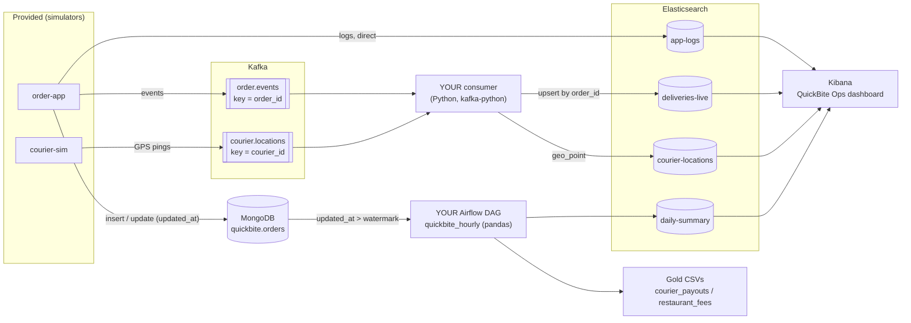

# QuickBite Capstone - Big Data Services

Self-study capstone for the **Big Data Services** module (Big Data Engineering, Naya College): Kafka, Elasticsearch + Kibana, MongoDB and Airflow in one pipeline for a fictional Israeli food-delivery app. Done at home, alone, nothing to hand in. About **4-5 hours**.

**Start here -> [handout.md](handout.md)** (all steps, commands, checkpoints and expected outputs).



**The story:** Ops needs real-time visibility of late deliveries and app errors before a busy weekend; Finance needs hourly/daily courier payouts and restaurant fees.

| Part | Topic | Time |
|---|---|---|
| 0 | Setup: compose up, seed 500 messy orders, start simulators | 30 min |
| 1 | MongoDB: find the data problems, pipeline update, aggregations | 45 min |
| 2 | Kafka: CLI, consumer group, dedupe, upsert, commit-after-write | 60 min |
| 3 | Elasticsearch & Kibana: templates before data, DSL/KQL, dashboard | 50 min |
| 4 | Airflow: incremental extract, pandas cleaning, DQ branch, Gold, watermark | 60 min |
| 5 | Incident drill: `drift`, `duplicates`, `errors`, `late` | 40 min |
| 6 | Reflection questions (+ Appendix A: CDC / Change Streams) | 20 min |

> **In the Spark module you will replace the pandas transform of Part 4 with PySpark.** No Spark here on purpose.

## Requirements

- Docker Desktop / Docker Engine with Compose v2.
- **RAM: an 8 GB laptop works.** Give Docker **at least 6 GB** (Docker Desktop -> Settings -> Resources -> Memory). Real use is about 5 GB (Elasticsearch 1 GB heap, Kibana, Airflow standalone, Mongo, Kafka KRaft, and a small Python container).
- ~6 GB of disk for the images. First `docker compose up` takes 5-10 minutes.

## Quickstart

```bash
docker compose up -d --build
docker compose ps                                   # wait until all show (healthy)
docker compose exec apps python /seed/seed_orders.py
# Kibana Dev Tools: run section A of part3_elk/mappings.http  (handout Part 0.5)
docker compose exec apps bash /apps/start_simulators.sh
```

## Ports and UIs

| Service | URL / address | Notes |
|---|---|---|
| Kibana | http://localhost:5601 | Dev Tools, Discover, Lens, Maps |
| Airflow | http://localhost:8080 | user `airflow` / password `airflow` |
| Elasticsearch | http://localhost:9200 | security disabled (practice only) |
| MongoDB | `localhost:27017` / `docker exec -it mongo mongosh` | single-node replica set `rs0` |
| Kafka | `course-kafka:9092` inside Docker, `localhost:29092` from the laptop | KRaft, no ZooKeeper |
| Kafdrop (optional) | http://localhost:9003 | `docker compose --profile ui up -d kafdrop` |

## Repo layout

```
docker-compose.yml           the whole stack (one file)
handout.md                   the exercise - start here
apps/
  simulators/                order_app.py, courier_sim.py (provided)
  consumer/consumer.py       Part 2 - YOU complete the TODOs
  common/                    shared catalog + chaos flags
  start_simulators.sh / stop_simulators.sh
seed/seed_orders.py          500 deterministic, messy historical orders
part1_mongo/explore.js       Part 1 - mongosh TODOs
part3_elk/mappings.http      Part 3 - index templates + queries (Kibana Dev Tools)
airflow/dags/                Part 4 - quickbite_hourly.py + quickbite_transform.py TODOs
chaos/chaos.py               Part 5 - incident modes
output/                      Gold / Silver / quarantine CSVs appear here
tests/                       pytest self-checks (no Kafka/ES needed)
solution/                    every student file solved and commented, + answers
TESTING.md                   what was verified before release
```

## Self-checks

```bash
docker compose exec apps pytest -q /tests/ --target=student    # your code
docker compose exec apps pytest -q /tests/                     # the solution
```

## Images and versions

`mongo:8.0` (same as the MongoDB lesson), `apache/kafka:3.8.1` in KRaft mode (the Kafka lessons used `wurstmeister/kafka` + ZooKeeper; KRaft is one container and less RAM; same broker name `course-kafka:9092` and same Python library `kafka-python`), Elasticsearch/Kibana `8.15.3`, `apache/airflow:2.8.4` (same as the Airflow lesson) in `standalone` mode, `python:3.11-slim` for the apps. No Logstash, Beats, Kafka Connect, Celery or Redis.

## Reset

`docker compose down -v` deletes all data; then follow the quickstart again. See [handout Appendix B](handout.md#appendix-b---troubleshooting).
