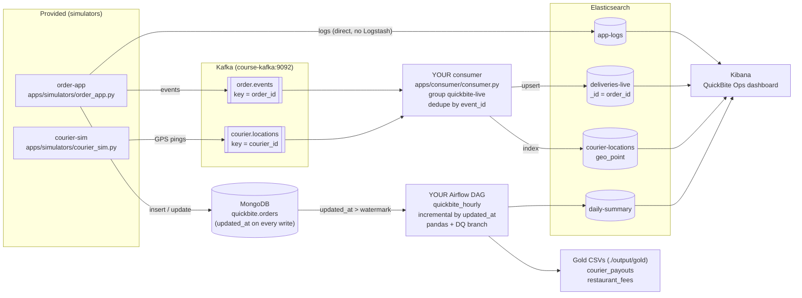
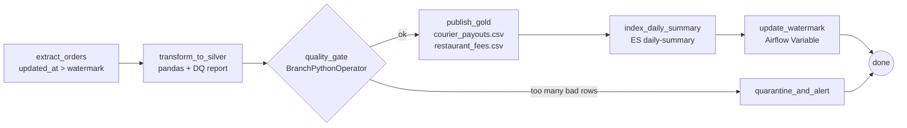
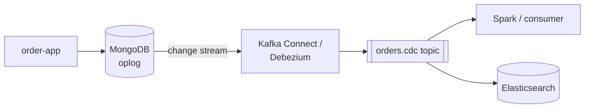

# QuickBite Capstone - Student Handout

**Big Data Services module, Naya College (Big Data Engineering)**
Self-study, at home, alone. Nothing is handed in. Total time: **about 4-5 hours**. Take breaks between parts.

You get one docker-compose stack with everything from the module (Kafka, Elasticsearch + Kibana, MongoDB, Airflow) and a small fictional company to run it for. Every part says which lesson it practises, gives exact commands, and ends with a **✅ checkpoint** that tells you what you should see. If you are stuck, every part has a **"Stuck? see solution/..."** link. Try first, then compare.

---

## The story

**QuickBite** is a (fictional) Israeli food-delivery app, like Wolt. It is Thursday. A busy weekend is coming.

- **Ops** wants to see *in real time* which deliveries are late, where the couriers are, and whether the app is throwing errors.
- **Finance** wants *every hour* what we owe each courier and what each restaurant owes us (commission).

The backend already exists, and you are the data engineer who builds the pipelines.



**The two paths** (this is the main idea of the whole module):

| | Speed path (streaming) | Batch path |
|---|---|---|
| Question | "What is happening **right now**?" | "What are the **correct numbers** for the day?" |
| Tools | Kafka -> Python consumer -> Elasticsearch -> Kibana | MongoDB -> Airflow + pandas -> CSV + Elasticsearch |
| Latency | seconds | one hour |
| Typical problem | duplicates, out-of-order events | messy types, late updates, re-runs |

| Part | What | Lesson | Time |
|---|---|---|---|
| [0](#part-0---setup-30-min) | Setup | all | 30 min |
| [1](#part-1---mongodb-explore-an-unknown-collection-45-min) | MongoDB: explore, find the problems, fix, aggregate | MongoDB | 45 min |
| [2](#part-2---kafka-the-live-consumer-60-min) | Kafka: inspect topics, write the consumer | Kafka 1 + 2 | 60 min |
| [3](#part-3---elasticsearch--kibana-50-min) | Elasticsearch & Kibana: mappings, queries, dashboard | ELK 1 + 2 | 50 min |
| [4](#part-4---airflow-the-hourly-batch-pipeline-60-min) | Airflow: the hourly batch pipeline | Airflow | 60 min |
| [5](#part-5---incident-drill-40-min) | Incident drill: 4 chaos modes | all | 40 min |
| [6](#part-6---reflection-20-min) | Reflection questions | all | 20 min |
| [A](#appendix-a---cdc-and-change-streams-reading-only) | CDC / Change Streams (reading only) | MongoDB | 10 min |
| [B](#appendix-b---troubleshooting) | Troubleshooting | - | - |

**Conventions**

- `$` lines run on **your laptop** in the repo folder. Lines inside a ```` ```javascript ```` block run in **mongosh**. Kibana requests run in **Kibana -> Dev Tools**.
- All code runs **inside containers**, so you install nothing on your laptop except Docker.
- Expected numbers come from a **deterministic** dataset (fixed random seed). **Numbers in Part 1 and Part 4.6 must match exactly.** Live numbers (simulators) are different for everybody: there you get a range.

---

## Part 0 - Setup (30 min)

**Goal:** the whole stack running, 500 historical orders in MongoDB, the simulators producing live data.

### 0.1 Requirements

- Docker Desktop (Windows/Mac) or Docker Engine (Linux), with Docker Compose v2 (`docker compose version`).
- **Memory: give Docker at least 6 GB** (8 GB is comfortable). Docker Desktop -> Settings -> Resources -> Memory. On an 8 GB laptop close Chrome tabs and other heavy apps while you work.
- About 6 GB of free disk for the images.
- Free ports: 27017, 9200, 5601, 8080, 29092 (and 9003 if you use Kafdrop). If you still have the Kafka/Mongo lesson containers running, stop them first: `docker ps` and then `docker compose down` in their folders. They use the same container names (`mongo`, `course-kafka`, `elasticsearch`, `kibana`).

### 0.2 Start everything

> **Mac users (zsh):** run `setopt interactivecomments` once in your terminal. Some commands below end with `# expected result`, and without this setting zsh treats `#` as part of the command.

```bash
docker compose up -d --build
docker compose ps
```

The first start downloads ~4 GB and builds two small images: **5-10 minutes**. Run `docker compose ps` every minute until all 6 services show **(healthy)**. `kibana` and `airflow` are the slowest (2-3 minutes after the others).

✅ **checkpoint:**

```
NAME            STATUS
airflow         Up 3 minutes (healthy)
apps            Up 4 minutes
course-kafka    Up 4 minutes (healthy)
elasticsearch   Up 4 minutes (healthy)
kibana          Up 3 minutes (healthy)
mongo           Up 4 minutes (healthy)
```

(`apps` has no healthcheck - "Up" is fine.)

| What | URL / address | Login |
|---|---|---|
| Kibana | http://localhost:5601 | - |
| Airflow | http://localhost:8080 | `airflow` / `airflow` |
| Elasticsearch | http://localhost:9200 | - |
| MongoDB | `docker exec -it mongo mongosh` | - |
| Kafdrop (optional) | http://localhost:9003 after `docker compose --profile ui up -d kafdrop` | - |

### 0.3 Check each service once

```bash
curl -s localhost:9200 | grep number          # "number" : "8.15.3"
docker exec mongo mongosh --quiet --eval 'rs.status().members[0].stateStr'     # PRIMARY
docker exec course-kafka /opt/kafka/bin/kafka-topics.sh --bootstrap-server localhost:9092 --list     # (empty - fine)
docker compose exec apps python -c "import kafka, elasticsearch, pymongo, pandas; print('apps OK')"
```

> Windows: no `grep`? Just open http://localhost:9200 in the browser.

### 0.4 Load the historical orders

```bash
docker compose exec apps python /seed/seed_orders.py
```

✅ **checkpoint:**
```
wrote /seed/orders.json (500 docs)
inserted 500 docs into quickbite.orders
inserted 20 docs into quickbite.restaurants
```

You can re-run this at any time to start Part 1 from a clean dataset (it drops and re-creates the two collections).

### 0.5 Create the log template, then start the simulators

The order-app writes its logs **directly into Elasticsearch** (no Logstash). Before the first log line arrives, Elasticsearch must know the field types (why? see Part 3.1).

1. Open **Kibana -> ☰ menu -> Management -> Dev Tools**.
2. Open `part3_elk/mappings.http` in your editor, copy **section A** (`PUT _index_template/app-logs` and its JSON body) into the console and run it (▶ button or Ctrl/Cmd+Enter).
   ✅ `{ "acknowledged": true }`
3. Start the simulators:

```bash
docker compose exec apps bash /apps/start_simulators.sh
```

✅ **checkpoint** (ids and names differ, the shape is what counts):
```
started order_app (pid 31) -> /apps/logs/order_app.log
started courier_sim (pid 32) -> /apps/logs/courier_sim.log
--- last lines of order_app.log ---
[order-app] created topic order.events (3 partitions)
[order-app] connected. First live order id: QB-200000. Ctrl+C to stop.
[order-app] + QB-200000  created    Pizza Yafo             active=1   events_sent=1
...
[courier-sim] round 1: sent 30 pings
```

Watch them live in a second terminal any time with `docker compose exec apps tail -f /apps/logs/order_app.log`. Stop with `bash /apps/stop_simulators.sh`.

> **Important for Part 1:** the simulators add about **20 new orders per minute** to `quickbite.orders` (ids `QB-2xxxxx`). The exact numbers in Part 1 are for the 500 historical orders only. Either do Part 1 **first and start the simulators after it**, or simply filter `{order_id: {$lt: "QB-2"}}`. Simplest is to re-run the seed (0.4) and stop the simulators while you do Part 1.

**Time compression:** in QuickBite-land a delivery promise is **2 minutes** (not 35), so you see late orders within minutes. About **1 in 7** live deliveries is late.

---

## Part 1 - MongoDB: explore an unknown collection (45 min)

**Lesson:** MongoDB (document model, BSON types, schema drift, CRUD, aggregation pipelines).
**Why:** before you build a pipeline on a source, you must know **what is really in it**. MongoDB does not enforce a schema: the same field can have a different type in every document. Your pipeline will crash (or worse, silently drop rows) on the type you did not expect.

**File:** `part1_mongo/explore.js` (it has the queries with `TODO`s and the expected outputs as comments).
**Stuck?** see `solution/part1_mongo/explore.js`.

Stop the simulators and re-seed so your numbers match:

```bash
docker compose exec apps bash /apps/stop_simulators.sh
docker compose exec apps python /seed/seed_orders.py
docker exec -it mongo mongosh quickbite
```

### 1.1 First five minutes (5 min)

```javascript
db.orders.countDocuments({})                     // 500
db.orders.findOne({ order_id: "QB-100000" })     // read every field name
db.orders.distinct("status")                     // 14 values!
```

✅ **checkpoint:** 500 documents. `distinct("status")` returns **14** values, although the business has only 5 statuses (`created, accepted, picked_up, delivered, cancelled`). That is your first data problem.

### 1.2 Find at least 5 data problems (15 min)

Fill in the TODOs 1.2b-1.2g in `explore.js`. Hints are in the file.

✅ **checkpoint** - your numbers must match:

| # | Question | Expected |
|---|---|---|
| a | `$type` of `total` | decimal **323**, double **120**, string **39**, missing **18** |
| b | `$type` of `created_at` | date **427**, string **43**, long **30** |
| c | no `status` field at all | **18** |
| d | per `schema_v` | v1 **241**, v2 **259**. `customer.email` exists in **241**, `customer.contact.email` in **259** (the app moved the email on 16 Oct) |
| e | empty `items` / any `items.qty` stored as a string | **10** / **85** |
| f | different spellings of `delivery_address.city` | **23** (for 8 real cities) |
| g | duplicated `order_id` | `QB-100040` and `QB-100041`, 2 copies each |

Write down your list of problems. **You will clean every one of them in Part 4.**

<details><summary>Hint for (e) "qty as a string"</summary>

`$type` on an array field matches if **any** element has that type: `db.orders.countDocuments({ "items.qty": { $type: "string" } })`.
</details>

### 1.3 CRUD fix: the status casing (10 min)

```javascript
db.orders.countDocuments({ status: "delivered" })     // 334
```

That 334 is wrong. Nobody gets an error, the number is just too small (`"DELIVERED"` and `"Delivered"` are missing). This is **silent exclusion**, the worst kind of bug.

Do TODO 1.3: **one** `updateMany` with a **pipeline update** (`[ { $set: ... } ]`) that lower-cases the status, **and sets `updated_at: "$$NOW"`**.

✅ **checkpoint:**
```
{ acknowledged: true, insertedId: null, matchedCount: 57, modifiedCount: 57, upsertedCount: 0 }
```
- `countDocuments({ status: "delivered" })` -> **374**
- `distinct("status")` -> 5 values
- run the update again -> `modifiedCount: 0` (the filter only matches docs that still need it, so the update is **idempotent**)

**Why also set `updated_at`?** In Part 4 the Airflow DAG reads only documents with `updated_at > last run`. If you change data without touching `updated_at`, **the pipeline never sees your change**. Every writer must keep that promise, including you with mongosh.

### 1.4 Aggregations (15 min)

Run them **after** 1.3. Do TODO 1.4a-1.4f.

✅ **checkpoint:**

| | Query | Expected |
|---|---|---|
| a | orders per status | delivered **374**, cancelled **50**, created **24**, picked_up **20**, `null` **18**, accepted **14** |
| b | revenue per raw city (delivered, `$convert` to decimal with `onError`/`onNull: 0`) | **23** groups; 1st `Tel Aviv` 70 orders **11010.00**; 2nd `Herzliya` 36 orders **10522.00** |
| c | same with `$toLower` + `$trim` (count only) | **18** groups; `tel aviv` **98** - but `tlv`, `tel-aviv`, `tel aviv-yafo` are still separate. Lower-casing is not enough; you need a **mapping table** (Part 4) |
| d | top 5 restaurants by revenue | R-15 Marina Fish 27 / **8634.00**; R-03 Pizza Yafo 28 / **5622.00**; R-16 Pituah Poke 25 / **4902.00**; R-18 Hadar Schnitzel 19 / **4551.00**; R-13 Holon Home Food 18 / **4343.00** |
| e | top 5 dishes by quantity (`$unwind` + `$toInt`) | Pizza Funghi **90**, Schnitzel Plate **72**, Garlic Bread **66**, Sabich **60**, Shawarma Laffa **58** |
| f | delivered after `promised_at` (`$expr`) | **117** (31% of 374 - Ops is right to worry) |

<details><summary>Why <code>$toInt</code> in (e)?</summary>

`$sum` silently **ignores** strings. Without `$toInt`, the 85 orders with `qty: "2"` would count as 0 and the ranking would be wrong, again without any error.
</details>

<details><summary>Why does (b) count a missing total as 0?</summary>

`onNull: 0` is fine for a quick look. In a real pipeline you would not silently treat missing money as 0: you would quarantine those rows and tell someone. That is exactly what the DAG does in Part 4.
</details>

### 1.5 OPTIONAL bonus: index + explain (only if you learned indexes)

The DAG will run `find({updated_at: {$gt: <watermark>}})` every hour. Follow the TODO in `explore.js`.

✅ **checkpoint:** `COLLSCAN` before; `FETCH -> IXSCAN` after the index, `totalDocsExamined` **88** = `nReturned` **88** (38 orders really changed after 29 Oct + your 57 fixed docs from 1.3, minus 7 in both). This is how the next DAG run will "see" your fix.

**Now restart the simulators** for the next parts:
```bash
docker compose exec apps bash /apps/start_simulators.sh
```

---

## Part 2 - Kafka: the live consumer (60 min)

**Lessons:** Kafka 1 (topics, partitions, offsets, keys) and Kafka 2 (producers/consumers in Python, consumer groups).
**Why:** Ops needs live data in Elasticsearch. The consumer is the bridge. It must survive restarts and duplicates without double-counting.

**File:** `apps/consumer/consumer.py`. **Stuck?** see `solution/apps/consumer/consumer.py`.

### 2.0 Before you start: the templates for your indices (5 min)

Your consumer will create `deliveries-live` and `courier-locations` the moment it writes the first document. If no template exists then, Elasticsearch guesses the field types and the map in Part 3 will not work. So **do Part 3.1 now** (create templates B, C, D from `part3_elk/mappings.http`), then come back here. Section 3.1 explains why.

### 2.1 Look at the topics from inside the broker (10 min)

The Kafka CLI tools live in `/opt/kafka/bin` inside the `course-kafka` container.

```bash
docker exec course-kafka /opt/kafka/bin/kafka-topics.sh --bootstrap-server localhost:9092 --list
docker exec course-kafka /opt/kafka/bin/kafka-topics.sh --bootstrap-server localhost:9092 --describe --topic order.events
```

✅ **checkpoint:** the list shows `__consumer_offsets`, `courier.locations`, `order.events` (`__consumer_offsets` shows up after the first consumer group). `--describe` shows **PartitionCount: 3**, ReplicationFactor 1, Leader 1 for partitions 0, 1, 2.

Read a few messages with the console consumer, **with keys**:

```bash
docker exec -it course-kafka /opt/kafka/bin/kafka-console-consumer.sh \
    --bootstrap-server localhost:9092 --topic order.events --from-beginning --max-messages 5 \
    --property print.key=true --property print.partition=true
```

✅ **checkpoint:** 5 lines like
```
Partition:1	QB-200000	{"event_id": "8b0c...", "order_id": "QB-200000", "event_type": "order_created", "status": "created", "ts": "2026-11-06T17:02:11.412Z", "restaurant_id": "R-03", "restaurant_name": "Pizza Yafo", "city": "Tel Aviv", "courier_id": null, "promised_at": "2026-11-06T17:04:11.412Z", "schema_v": 2, "total": 122.0}
Processed a total of 5 messages
```

Answer for yourself:
1. Run the command again, adding `--partition 1 --offset 0` (and removing `--from-beginning`). Do all events of one `order_id` land in the **same** partition? Why does that matter? (*Kafka 1: same key -> same partition -> ordered.*)
2. Where is the event's "time" stored, and why is it a string with a `Z` at the end?

### 2.2 Consumer groups and lag (5 min)

```bash
docker exec course-kafka /opt/kafka/bin/kafka-consumer-groups.sh --bootstrap-server localhost:9092 --list
```
Nothing yet. Your consumer will create the group `quickbite-live`. Remember this command; you will use it in 2.8.

### 2.3 Run the skeleton and configure the consumer (10 min)

```bash
docker compose exec apps python /apps/consumer/consumer.py
```

It runs, reads `order.events` and prints counts, but writes nothing. Stop it (Ctrl+C) and do **TODO 2.3** (the `KafkaConsumer(...)` call in `main()`):

| Setting | Value | Why |
|---|---|---|
| topics | `ORDER_TOPIC, COURIER_TOPIC` | one consumer can subscribe to several topics |
| `group_id` | `GROUP_ID` (`quickbite-live`) | Kafka stores **our** offset under this name -> after a restart we continue where we stopped; several copies of the consumer share the partitions |
| `auto_offset_reset` | `"earliest"` | the first time the group starts there is no stored offset: start from the beginning, not the end |
| `enable_auto_commit` | `False` | auto-commit saves the offset on a timer, even if our Elasticsearch write failed -> data loss. We commit ourselves, after the write (2.8) |

✅ **checkpoint:** run again -> `courier pings=` is now growing too.

### 2.4 Dedupe by event_id (5 min)

Kafka gives you **at-least-once** delivery: after a crash or a producer retry you can get the same event again. Every event has a unique `event_id`. Do **TODO 2.4** (`SeenEvents.is_duplicate`).

Test it without Kafka (quick feedback loop - use it for 2.4-2.7):
```bash
docker compose exec apps pytest -q /tests/test_consumer.py --target=student -k seen
```
✅ **checkpoint:** `2 passed, 14 deselected`

### 2.5 The is_late flag (10 min)

Do **TODO 2.5** (`compute_is_late`). The rule is in the docstring.

```bash
docker compose exec apps pytest -q /tests/test_consumer.py --target=student -k is_late
```
✅ **checkpoint:** `8 passed, 8 deselected`

### 2.6 Upsert by order_id (5 min)

Do **TODO 2.6** (`delivery_action`). An order produces 4-5 events (created, accepted, picked_up, delivered). Ops wants **one row per order** with its latest state, not one per event.

- `_id = order_id` -> every event of the order updates **the same** document
- `"_op_type": "update"` + `"doc_as_upsert": True` -> creates it on the first event, merges the fields after that
- result: writing the same event twice gives the same document. The write is **idempotent**. That is your second safety net against duplicates (the dedupe set is lost on restart, the `_id` is not).

### 2.7 Courier positions (5 min)

Do **TODO 2.7** (`courier_action`): `_id = courier_id` (keep only the latest position of each of the 30 couriers), and `location` as `{"lat": ..., "lon": ...}`.

```bash
docker compose exec apps pytest -q /tests/test_consumer.py --target=student -m "not part5"
```
✅ **checkpoint:** `15 passed, 1 deselected` (the deselected one is for Part 5).

### 2.8 Write, THEN commit (10 min)

Do **TODO 2.8**: `helpers.bulk(es, actions, raise_on_error=True)` and **after it** `consumer.commit()`.

**Why this order?** If the consumer crashes **after** the write and **before** the commit, Kafka re-delivers the batch -> a few duplicates -> your dedupe + upsert absorb them. With the opposite order (commit first) a crash means those events are **lost forever**. "At-least-once + idempotent writes" is the standard pattern.

Run it and leave it running in its own terminal for the rest of the exercise:
```bash
docker compose exec apps python /apps/consumer/consumer.py
```

✅ **checkpoint** (after ~1 minute):
```
[consumer] order events=412 courier pings=1380 duplicates skipped=0 bad=0 | actions built this batch=37
```
In another terminal:
```bash
curl -s "localhost:9200/_cat/indices/deliveries-live,courier-locations?v&h=index,docs.count"
docker exec course-kafka /opt/kafka/bin/kafka-consumer-groups.sh --bootstrap-server localhost:9092 --describe --group quickbite-live
```
- `courier-locations` has exactly **30** docs (one per courier, `_id = courier_id`).
- `deliveries-live` doc count is roughly the number of **orders** (not events). It grows by ~20 per minute.
- `kafka-consumer-groups --describe` shows 4 partitions (3 + 1) with **LAG** close to 0.

**Try it:** stop the consumer for 1 minute (Ctrl+C), run `--describe` again (LAG grows), start the consumer again (LAG goes back to ~0, nothing is lost, no doc count jumps).

---

## Part 3 - Elasticsearch & Kibana (50 min)

**Lessons:** ELK 1 (Elasticsearch: index, mapping, Query DSL) and ELK 2 (Kibana: Discover, KQL, Lens, Maps, dashboards).
**File:** `part3_elk/mappings.http`. **Stuck?** see `solution/part3_elk/mappings.http` and `solution/part3_dashboard_steps.md`.

### 3.1 Index templates BEFORE the data (10 min) - done in Part 2.0

If you write a document into an index that does not exist, Elasticsearch creates it and **guesses** the types (dynamic mapping):

| You send | Elasticsearch guesses | Problem |
|---|---|---|
| `"status": "delivered"` | `text` + `status.keyword` | aggregations need `status.keyword`; easy to get wrong |
| `"location": {"lat": 32.08, "lon": 34.78}` | two `float`s | **not a geo_point -> Kibana Maps cannot draw it** |
| `"promised_at": "2026-11-06T17:04:11.412Z"` | `date` (lucky this time) | a date sent first as a number becomes `long` forever |

**A field's mapping can never be changed** once the index exists. The fix is delete + reload. So: templates first, data second. An **index template** says "every new index whose name matches `deliveries-live*` gets this mapping".

Complete the TODOs in sections **B, C, D** of `mappings.http` and run them in Dev Tools.

✅ **checkpoint:**
```
GET _cat/templates/app-logs,deliveries-live,courier-locations,daily-summary?v&h=name,index_patterns
```
lists all 4 templates. **After** the consumer ran (Part 2.8):
```
GET courier-locations/_mapping/field/location
```
shows `"type": "geo_point"`.

> **Did the consumer run before you created the templates?** Then the mapping is wrong (`location` is two floats). Fix it (also listed at the bottom of `mappings.http`): stop the consumer -> `DELETE deliveries-live` and `DELETE courier-locations` in Dev Tools -> reset the group offsets (Appendix B.6) -> start the consumer. It rebuilds both indices from Kafka. **Elasticsearch is a view you can always rebuild, as long as Kafka keeps the events.**

### 3.2 Query DSL (10 min)

Run the queries a-e in the second half of `mappings.http` (TODOs in a, c, d).

✅ **checkpoint** (live data - ranges, not exact numbers):
- (a) ERROR logs in the last 15 minutes: a small number, ~1-2% of the log lines (before Part 5).
- (b) errors per service: `payment-service`, `order-service`, `dispatch-service` with `avg_latency` in the hundreds to low thousands of ms.
- (c) late deliveries per city: `Tel Aviv` first (most restaurants are there).
- (d) a few couriers within 2 km of Dizengoff Center.
- (e) messages containing "timeout" - a `match` on a `text` field. Try `term` instead of `match` on `message`: 0 hits. Why? (`text` is split into words and lower-cased; `term` looks for the exact token.)

### 3.3 Data view + Discover + KQL (10 min)

1. **Kibana -> ☰ -> Stack Management -> Data Views -> Create data view**: Name `app-logs`, Index pattern `app-logs*`, Timestamp field `@timestamp`. Save.
2. Repeat for `deliveries-live*` (timestamp **`last_event_ts`**), `courier-locations*` (timestamp `ts`) and `daily-summary*` (timestamp `date`; it will have data after Part 4).
3. **☰ -> Discover**, choose `app-logs`, time picker **Last 15 minutes**. Try these KQL searches:
   - `level:ERROR`
   - `level:ERROR and service:"payment-service"`
   - `message:timeout`
4. Switch to `deliveries-live`:
   - `status:delivered and is_late:true`
   - `status:picked_up and promised_at < now` - open orders that are **already** late (computed at query time)

✅ **checkpoint:** each search returns documents; clicking a document shows `is_late` as a boolean and `location` with a globe icon (geo_point) in `courier-locations`.

### 3.4 Build the "QuickBite Ops" dashboard (20 min)

**☰ -> Dashboards -> Create dashboard.** Set the time picker to **Last 30 minutes** and auto-refresh to **10 seconds** (calendar icon -> Refresh every).
Add these 6 panels (**Create visualization** opens Lens; drag fields from the left list):

| # | Panel | Data view | How (Lens) |
|---|---|---|---|
| 1 | **Couriers now** (map) | courier-locations | Dashboard toolbar -> **Add panel -> Maps** (or ☰ -> Maps -> Create map) -> **Add layer -> Documents** -> data view `courier-locations`, geospatial field `location` -> Style: fill color **by value** `state`. Save and return to dashboard |
| 2 | **Late deliveries** (metric) | deliveries-live | Visualization type **Metric** -> Primary metric: **Count**; in the panel's KQL bar: `is_late:true and status:delivered` |
| 3 | **Late % by city** (bar) | deliveries-live | **Bar vertical** -> horizontal axis `city` (Top values, 8) -> vertical axis: **Formula** `count(kql='is_late:true') / count() * 100` |
| 4 | **Error rate** (line) | app-logs | **Line** -> horizontal axis `@timestamp` (Date histogram, 30 s) -> vertical axis: **Formula** `count(kql='level:ERROR') / count() * 100` -> "Breakdown" by `service` |
| 5 | **Slowest services** (table) | app-logs | **Table** -> Rows `service` -> Metrics: Count, **95th percentile** of `latency_ms` |
| 6 | **Revenue per day** (bar, after Part 4) | daily-summary | **Bar vertical** -> horizontal `date` (Date histogram, 1 day) -> vertical **Sum** of `revenue_ils`. Set the panel time range to **Last 60 days** (panel ⋯ -> Edit panel settings / custom time range), because the history is from October |

Save the dashboard as **QuickBite Ops**.

✅ **checkpoint:** a map with 30 dots around Tel Aviv / Gush Dan that move every 5-10 seconds; a late-deliveries number that grows; the error-rate line around 1-2%; later (Part 4) 30 bars for October.

Full click-by-click steps with screenshots-in-words: `solution/part3_dashboard_steps.md`.

---

## Part 4 - Airflow: the hourly batch pipeline (60 min)

**Lesson:** Airflow (DAGs, operators, Variables, retries, branching).
**Why:** the live view is fast but not exact (events can arrive late, statuses change). Finance needs **correct** numbers, recomputed every hour from the system of record (MongoDB), cleaned the way you planned in Part 1.

**Files:** `airflow/dags/quickbite_hourly.py` (Airflow wiring) and `airflow/dags/quickbite_transform.py` (pure pandas, no Airflow).
**Stuck?** see `solution/airflow/dags/`.



> **In the Spark module you will replace this pandas transform with PySpark.** Everything in `quickbite_transform.py` (flatten, normalize, quality rules, group-by) maps 1:1 to DataFrame operations. The Airflow part stays the same.

### 4.0 Look at the DAG in the UI (5 min)

Open http://localhost:8080 (`airflow` / `airflow`). The DAG `quickbite_hourly` is listed (paused). Click it -> **Graph**. Do the two **TODO 4.0** items in `quickbite_hourly.py` (retries in `default_args`). Airflow re-reads the file within ~30 s.

✅ **checkpoint:** no red "Broken DAG" banner on the DAGs page. (If there is one: click it, read the Python error, fix, wait 30 s.) The graph shows 8 tasks with two branches after `quality_gate`.

### 4.1 Incremental extract with a watermark (10 min)

Do **TODO 4.1** in `extract_orders`.

- Read only `{"updated_at": {"$gt": since}}`, sorted by `updated_at`.
- The **new watermark = the max `updated_at` you actually read**, not `datetime.now()`. With `now()`, a document written between your query and `now()` would be skipped **forever**.
- The watermark lives in an **Airflow Variable** (`quickbite_watermark`), because the next run (a different process, maybe hours later) must find it.

### 4.2 The pandas cleaning - your Part 1 list (15 min)

Do **TODO 4.2a-e** in `quickbite_transform.py`: `normalize_status`, `to_float_total`, `to_utc_timestamp`, `coalesce_email`, `normalize_city`. Each docstring says exactly what to do.

Test them without Airflow (fast feedback):
```bash
docker compose exec apps pytest -q /tests/test_transform.py --target=student -k "status or total or timestamp or email or city"
```
✅ **checkpoint:** all selected tests pass.

### 4.3 Data-quality gate with BranchPythonOperator (10 min)

Do **TODO 4.3** (three places):
1. `split_quality()` in `quickbite_transform.py`: the `missing_status` and `bad_total` rules.
2. `quality_decision()` in `quickbite_transform.py`.
3. `quality_gate()` in the DAG must **return the task_id** to run next; and the `done` task needs `trigger_rule="none_failed_min_one_success"`. Without it, `done` is **skipped** every time (one branch is always skipped, and the default rule `all_success` treats "skipped" as "not success").

```bash
docker compose exec apps pytest -q /tests/test_transform.py --target=student
```
✅ **checkpoint:** all pass except `test_order_total_coalesces_v3_payment_amount` (that one is for Part 5). `test_seed_expected_numbers` checks the exact numbers of 4.6.

### 4.4 Gold + daily-summary (5 min)

`publish_gold` is provided (read it: Silver is merged with an **upsert by order_id**). Do **TODO 4.4** in `index_daily_summary`: bulk-index one doc per day into `daily-summary`. Use **`_id = date`**, so a re-run overwrites the day instead of adding a copy (idempotent, like `_id = order_id` in Part 2).

### 4.5 Move the watermark - as the LAST task (2 min)

Do **TODO 4.5**: `Variable.set(WATERMARK_VAR, info["new_watermark"])`.

**Why last?** If `publish_gold` fails and the watermark had already moved (in `extract_orders`), the next run would start **after** the failed window: those orders are never processed. Moving it last means "a failed run is simply repeated".

### 4.6 Run it (13 min)

1. In the UI: unpause `quickbite_hourly` (toggle) and click **▶ Trigger DAG**.
2. **Grid** view -> click each square -> **Logs**.

✅ **checkpoint - first run** (if you did Part 1.3 and the simulators ran for a while, `input_rows` will be bigger; to compare exactly, re-seed and stop the simulators first):

`extract_orders` log:
```
watermark=1970-01-01T00:00:00.000Z  ->  extracted 500 changed orders  ->  new watermark=2026-10-30T22:47:07.976Z
```
`transform_to_silver` log:
```
"input_rows": 500, "clean_rows": 462, "quarantined_rows": 38, "duplicate_rows": 2,
"duplicate_order_ids": ["QB-100040", "QB-100041"], "missing_status": 18, "bad_total": 18,
"empty_items": 10, "bad_pct": 7.2
```
`quality_gate`: `bad_pct=7.2 (max 10.0), duplicate_rows=2 (max 5) -> ok=True` -> `publish_gold` runs, `quarantine_and_alert` is **skipped** (pink).
`publish_gold`: `silver=462 orders | courier_payouts=290 rows | restaurant_fees=274 rows | days=30`
`index_daily_summary`: `indexed 30 daily-summary docs`

On your laptop:
```bash
ls output/gold output/silver output/quarantine
head -3 output/gold/courier_payouts.csv output/gold/restaurant_fees.csv
```
```
==> output/gold/courier_payouts.csv <==
date,courier_id,deliveries,on_time,late,payout_ils
2026-10-01,C-07,1,0,1,15.0
2026-10-01,C-09,2,0,2,30.0

==> output/gold/restaurant_fees.csv <==
date,restaurant_id,restaurant_name,orders,gross_ils,commission_pct,fee_ils,net_ils
2026-10-01,R-06,Green Bowl,1,300.0,20.0,60.0,240.0
2026-10-01,R-11,Pasta Bursa,2,654.0,22.0,143.88,510.12
```
(Finance rule: a courier gets ILS 15 per delivery + ILS 3 when on time.)

- **Admin -> Variables**: `quickbite_watermark` = `2026-10-30T22:47:07.976Z` (seed only).
- Kibana Dev Tools: `GET daily-summary/_count` -> `30` (seed only).

3. **Trigger it again.** ✅ Only the orders changed since the last run are extracted (with the simulators running: a few hundred; without them: `extracted 0 changed orders`). The watermark moves forward. `daily-summary` still has one doc per day (now including today).

4. **See the branch fail on purpose:** Admin -> Variables -> **+** -> key `quickbite_max_bad_pct`, value `5`. Reset the watermark to `1970-01-01T00:00:00.000Z` and trigger. ✅ `quality_gate` -> `quarantine_and_alert` runs, `publish_gold`/`update_watermark` are **skipped**, the watermark **does not move**, a CSV appears in `output/quarantine/`, and an alert doc lands in the ES index `pipeline-alerts`. Delete the `quickbite_max_bad_pct` Variable afterwards and trigger again so Gold is published.

5. Kibana: the **Revenue per day** panel (3.4 #6) now has bars.

**Retries:** temporarily stop Elasticsearch (`docker compose stop elasticsearch`), trigger the DAG, watch `index_daily_summary` go **up_for_retry** (yellow) in the Grid. Start Elasticsearch again (`docker compose start elasticsearch`) before the 2nd retry: the task succeeds without anyone re-running the DAG.

---

## Part 5 - Incident drill (40 min)

**All lessons together.** Real pipelines break because the world changes, not because your code was wrong when you wrote it. Run **one** chaos mode at a time and keep the dashboard open (auto-refresh 10 s). For each one answer the three questions:

> **1. What broke?  2. Where did you see it (which panel / log / check)?  3. How do you fix it (which file, which function)?**

The script tells you only what a "status page" would tell you. Detecting the effect is your job.

```bash
docker compose exec apps python /chaos/chaos.py status     # what is active
docker compose exec apps python /chaos/chaos.py reset      # back to normal
```

Make sure the simulators and your consumer are running.

### 5.1 `drift` (12 min)

```bash
docker compose exec apps python /chaos/chaos.py drift
```
Wait 2-3 minutes. Look at the dashboard (Late % by city, Late deliveries), Discover on `deliveries-live` (look at the `status` and `total` of the newest docs), and trigger the DAG and read the `transform_to_silver` log.

<details><summary>Hint</summary>

Compare a new event with an old one in the console consumer (Part 2.1). Two fields changed. One of them is a **case** change, the other is a **move**.
</details>

When you found it, fix it in the code: `normalize_status()` and `event_total()` in `consumer.py`, `order_total()` in `quickbite_transform.py`. Then:
```bash
docker compose exec apps pytest -q /tests/test_consumer.py --target=student -m part5
docker compose exec apps pytest -q /tests/test_transform.py --target=student -k v3
```
✅ **checkpoint:** `1 passed` for each. Restart the consumer; the new docs look normal again. Trigger the DAG: the gate passes again.

### 5.2 `duplicates` (8 min)

```bash
docker compose exec apps python /chaos/chaos.py duplicates
```
Look at the consumer's console line, the `deliveries-live` doc count, and the **Late deliveries** number. Did anything double? Why not? What would have happened **without** dedupe and **without** `_id = order_id`? Then restart the consumer and run the same mode again: what is different the second time? (Hint: where does `SeenEvents` live?)

### 5.3 `errors` (8 min)

```bash
docker compose exec apps python /chaos/chaos.py errors     # lasts 3 minutes
```
Look at the **Error rate** and **Slowest services** panels and Discover (`level:ERROR`). Which service? What is the p95 latency? Is it only logs, or do orders change too? (Look at `cancel_reason` in `deliveries-live`.) Finance asks: how many orders failed at payment yesterday? Add a `payment_failed` count to `daily_summary()` in `quickbite_transform.py` (see the TODO).

### 5.4 `late` (12 min)

```bash
docker compose exec apps python /chaos/chaos.py late       # lasts 5 minutes
```
Look at the map (colour by `state`), and at **Late deliveries** during the 5 minutes and right after. Now look at the open orders: in Discover run `status:picked_up and promised_at < now`, then `status:picked_up and is_late:true`. Why do the two numbers differ? Which one is correct? Fix the consumer so the dashboard is right **during** the incident, not only after orders finally get delivered.

<details><summary>Hint</summary>

`is_late` is computed when an **event** arrives. A courier who is stuck sends no order event. What still runs every few seconds in your consumer loop?
</details>

Answers for all four: `solution/part5_chaos_answers.md`.
After the drill: `chaos.py reset`.

---

## Part 6 - Reflection (20 min)

Write a short answer (2-5 sentences) to each. Answers: `solution/part6_reflection_answers.md`.

1. A customer's order is **deleted** from MongoDB (GDPR request). Will the hourly DAG ever find out? Why not, and what does that mean for `courier_payouts.csv`?
2. An order is updated **twice** between two DAG runs (accepted at 10:05, delivered at 10:40). What does the 11:00 run see? What did you **lose**, and does Finance care?
3. The Airflow container was down for **2 days**. What happens at the first run after it comes back? Is anything lost? Would anything be lost if you had used `datetime.now() - 1 hour` instead of a watermark?
4. Why does `deliveries-live` use `_id = order_id`? Give two concrete failures that this one decision protects you from.
5. The consumer computes `is_late`, and the DAG computes `is_late` too. They can disagree. When, and which one is "the truth"?
6. Your Gold CSV is wrong for 3 October (a bug in the city mapping). How do you **re-process just that day** with this design? What would make it easier?
7. In the Spark module you will replace pandas. Which functions of `quickbite_transform.py` become which Spark operations? Which part of the DAG does **not** change?
8. You may run **two** copies of the consumer (same group). What happens with the partitions? Could you run **four**? What decides the maximum useful number?

---

## Appendix A - CDC and Change Streams (reading only)

Part 6 showed three gaps of the "query by `updated_at`" approach:

| Gap | Why |
|---|---|
| **Deletes are invisible** | a deleted document has no `updated_at` any more - there is nothing to find |
| **Intermediate states are lost** | you see only the **latest** version at query time, not every change |
| **Everyone must set `updated_at`** | one writer that forgets (a mongosh fix, a migration script) and the change is never extracted |

**CDC (Change Data Capture)** solves all three by reading the database's own **change log** instead of querying the data.

- MongoDB keeps every write in the **oplog**, a capped collection that only exists on a **replica set** (that is why our compose runs `mongod --replSet rs0` even with one node).
- A **Change Stream** (`db.orders.watch()`) is the official, safe API over the oplog. Each event says `operationType: insert | update | replace | delete`, the `documentKey` (the `_id`), and for updates what changed. Deletes arrive as events too.
- Each event has a **resume token**. Save it after processing; after a restart call `watch(resume_after=token)` and you continue exactly where you stopped. That is the same idea as the Kafka consumer offset.
- The oplog is capped: if your consumer is down longer than the **oplog window**, the token points to history that is gone and you need a new full snapshot.
- In production you usually don't write this yourself: the **MongoDB Kafka source connector** (Kafka Connect) or **Debezium** reads the change stream and writes every change to a Kafka topic. Then the architecture becomes:



Notice what disappeared: the app no longer has to write to Mongo **and** to Kafka (a "dual write" that can fail halfway), and no watermark is needed.

Try it (optional, 2 minutes) in mongosh while the simulators run:
```javascript
const cs = db.getSiblingDB("quickbite").orders.watch();
while (true) { if (cs.hasNext()) { const e = cs.next(); print(e.operationType, e.documentKey._id, JSON.stringify(e.updateDescription?.updatedFields ?? {})); } }
// Ctrl+C to stop
```

---

## Appendix B - Troubleshooting

**B.1 A port is busy** (`Bind for 0.0.0.0:27017 failed: port is already allocated`)
Something else uses the port, usually a container from an earlier lesson. `docker ps` -> stop it (`docker stop <name>`), or `docker compose down` in that lesson's folder. A local MongoDB / Elasticsearch installation can also hold the port.
`Conflict. The container name "/mongo" is already in use`: a leftover from the Mongo lesson. `docker rm -f mongo` (removes the container, not your files), then `docker compose up -d` again. Same for `course-kafka`, `elasticsearch` and `kibana` (leftovers from the ELK lessons). To clear all of them at once: `docker rm -f mongo course-kafka elasticsearch kibana`.

**B.1b `docker compose up --build` fails with `SSL: CERTIFICATE_VERIFY_FAILED` during `pip install`**
Your network inspects HTTPS traffic (common on company laptops with Zscaler/Netskope or a VPN), so containers do not trust its certificate. Build at home or on a personal laptop, or disconnect the VPN and run `docker compose build --no-cache` again.

**B.2 Elasticsearch exits with code 137, or keeps restarting**
137 = killed for using too much memory. Give Docker more memory (Docker Desktop -> Settings -> Resources -> Memory >= 6 GB), close other apps, `docker compose up -d` again.
If the log (`docker compose logs elasticsearch`) says `max virtual memory areas vm.max_map_count [65530] is too low`:
- Linux: `sudo sysctl -w vm.max_map_count=262144`
- Windows (WSL2): `wsl -d docker-desktop sysctl -w vm.max_map_count=262144`
- Mac (Docker Desktop): usually not needed; if it is, restart Docker Desktop.

**B.3 Everything is slow / the laptop fans scream**
Expected on 8 GB. Real use is ~5 GB. Do not start Kafdrop. Stop the simulators when you do not need live data (`stop_simulators.sh`). `docker stats` shows who uses what. Lower the rate: `ORDERS_PER_MIN` in `docker-compose.yml` -> `docker compose up -d apps`.

**B.4 Airflow is slow at the first start / "Broken DAG"**
The first start runs `airflow db migrate`: 1-3 minutes before http://localhost:8080 answers. `docker compose logs -f airflow` shows the progress. A **Broken DAG** banner shows a Python error in your DAG file - click it, read the last line, fix the file, wait ~30 s. The standalone mode runs one task at a time (SequentialExecutor) - that is expected.
Login does not work? The user is created on start: `docker compose restart airflow`, wait 2 minutes.

**B.5 `order-app` stops with "index template 'app-logs' not found"**
You skipped Part 0.5 step 2. Run section A of `mappings.http` in Dev Tools, then `start_simulators.sh` again.

**B.6 Re-read Kafka from the beginning (rebuild the ES indices)**
Stop the consumer first (Ctrl+C), then:
```bash
docker exec course-kafka /opt/kafka/bin/kafka-consumer-groups.sh --bootstrap-server localhost:9092 \
    --group quickbite-live --reset-offsets --to-earliest --all-topics --execute
```

**B.7 The map shows nothing**
`GET courier-locations/_mapping/field/location` must say `geo_point`. If not -> Part 3.1 "Did the consumer run before you created the templates?". Also check the time picker (Last 15 minutes) and that the consumer is running.

**B.8 Reset everything**
```bash
docker compose down -v        # -v deletes ALL data volumes (Mongo, Elasticsearch, Airflow DB)
docker compose up -d --build
```
then Part 0.4 and 0.5 again. Your code files are not touched. To also delete the Gold CSVs: delete the files inside `output/` (keep `output/.gitkeep`).

**B.9 Windows line endings** - `bash: /apps/start_simulators.sh: /usr/bin/env: 'bash\r'`: your git converted the file to CRLF. Run `git config core.autocrlf input`, delete the repo folder and clone again (or convert the two `.sh` files to LF in VS Code, bottom-right corner).

---

## Solutions

Try first. Then compare - the comments explain **why**, which is the part worth reading.

| Part | Solution |
|---|---|
| 1 | [solution/part1_mongo/explore.js](solution/part1_mongo/explore.js) |
| 2 | [solution/apps/consumer/consumer.py](solution/apps/consumer/consumer.py) (includes the Part 5 fixes) |
| 3 | [solution/part3_elk/mappings.http](solution/part3_elk/mappings.http), [solution/part3_dashboard_steps.md](solution/part3_dashboard_steps.md) |
| 4 | [solution/airflow/dags/quickbite_hourly.py](solution/airflow/dags/quickbite_hourly.py), [solution/airflow/dags/quickbite_transform.py](solution/airflow/dags/quickbite_transform.py) |
| 5 | [solution/part5_chaos_answers.md](solution/part5_chaos_answers.md) |
| 6 | [solution/part6_reflection_answers.md](solution/part6_reflection_answers.md) |

Run the solution consumer instead of yours: `docker compose exec apps python /solution/apps/consumer/consumer.py`.
Run the solution DAG instead of yours: `cp solution/airflow/dags/*.py airflow/dags/` (make a copy of your files first!).
Check everything: `docker compose exec apps pytest -q /tests/` (solution) or `... --target=student` (yours).
